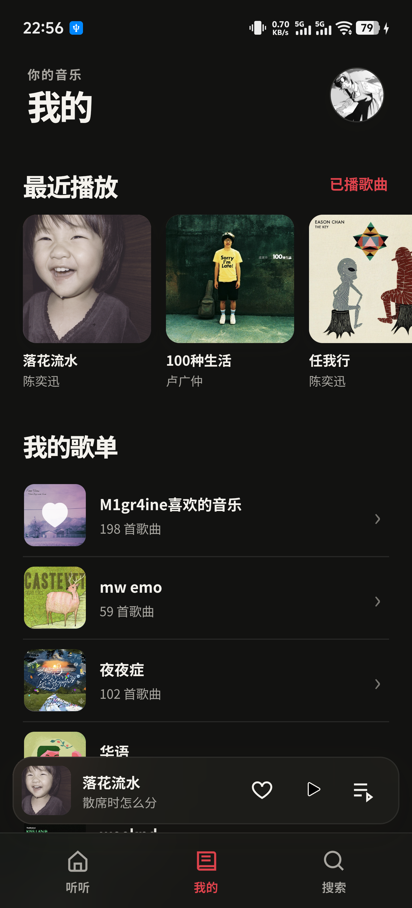
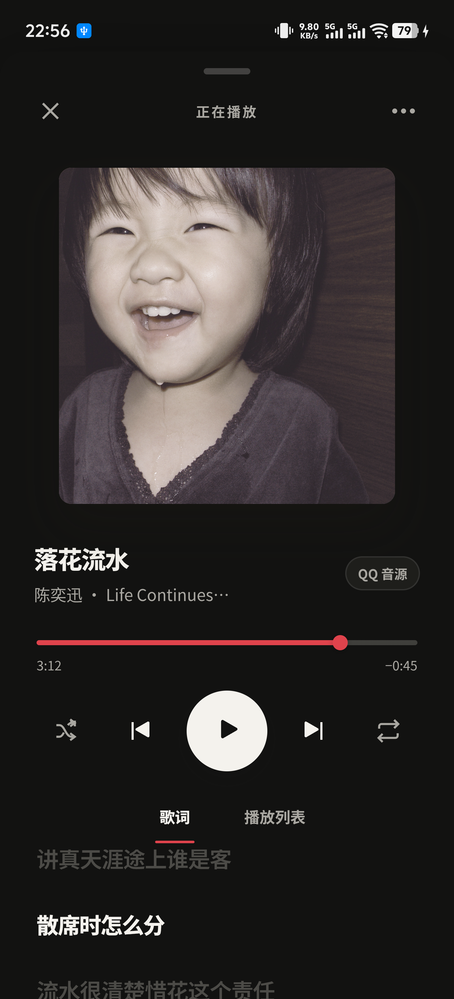
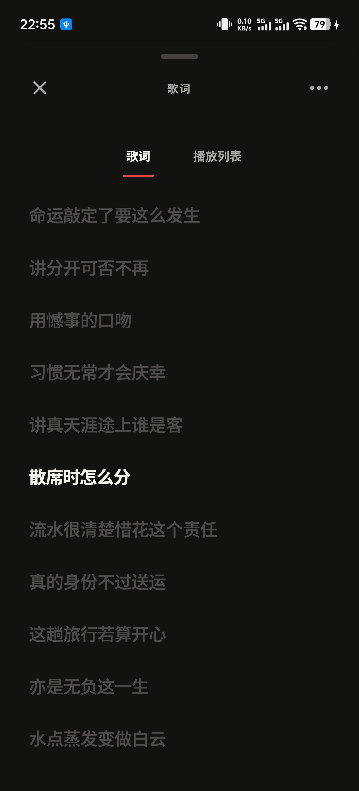
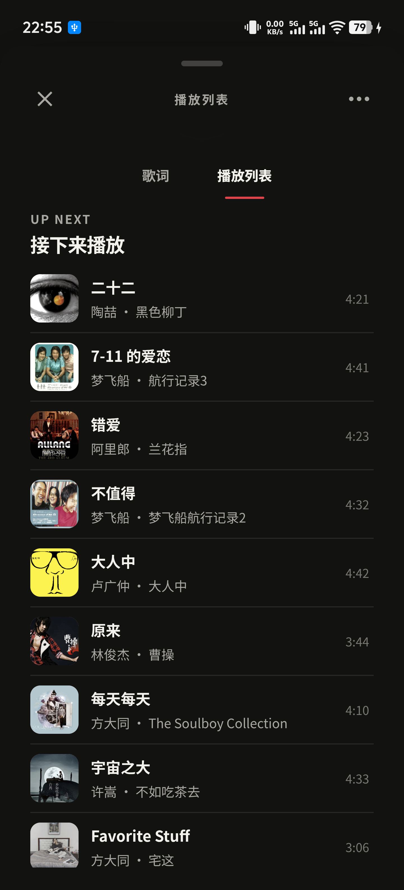

# YesPlayMusic Mobile

YesPlayMusic 的 Android 移动版，采用接近 Apple Music 的界面，并保留 YesPlayMusic 的音乐服务思路。项目基于 [qier222/YesPlayMusic](https://github.com/qier222/YesPlayMusic) 的开源项目与交互设计独立适配，**不是上游官方 Android 应用**，也不隶属于网易、腾讯、vivo、iQOO 或 Apple。

当前源码版本：**0.2.11**（versionCode 13）。本目录可以独立构建 APK，包含 Android 源码、实机截图和试用版安装包。

[下载最新版 APK](https://github.com/M1gr4ine/YesPlayMusic-Mobile/releases/latest) · [v0.2.11 发布说明](https://github.com/M1gr4ine/YesPlayMusic-Mobile/releases/tag/v0.2.11)

## 实机截图

截图来自 iQOO 手机上运行的 0.2.9。状态栏、账号名称和当前播放内容保留了实机原样；歌曲、专辑封面与歌词的权利仍归各自权利人。

| 听听 | 我的 |
| :---: | :---: |
|  |  |

| 播放器封面 | 全屏歌词 | 播放列表 |
| :---: | :---: | :---: |
|  |  |  |

## 功能

- 听听、我的、搜索页面，采用 Apple Music 风格的排版与配色。
- 网易云音乐和 QQ 音乐搜索、歌单与播放，包含 QQ 音源与来源偏好设置。
- 登录用户信息、收藏、歌单、播放历史和同步歌词。
- Android 后台播放服务、通知栏媒体控制、锁屏媒体信息及 MediaSession/MediaBrowser 接口，可供 OriginOS 原子随身听等系统入口读取播放状态。
- 全屏播放器支持封面、同步滚动歌词和播放列表。上划展开全屏歌词；在全屏歌词顶部标签附近下拉回到封面，正文区域上下滑动浏览歌词；左滑打开播放列表，右滑回歌词。头像打开设置时有弹出动画；设置页支持下滑关闭。

系统卡片和通知的具体样式由 Android 与手机厂商控制，会随设备和 OriginOS 版本变化。

## 安装包

试用 APK 放在 [`releases/`](releases/) 目录，并附有 SHA-256 校验文件。安装前可按下面的命令核对：

```sh
cd releases && sha256sum -c SHA256SUMS.txt
```

Windows PowerShell：

```powershell
Get-FileHash .\releases\YesPlayMusic-Mobile-v0.2.11.apk -Algorithm SHA256
```

本次音源匹配、界面和安装包一致性的验证结果见[验证记录](docs/VERIFICATION-v0.2.11.md)。安装包和 SHA-256 校验文件同时提供在 [GitHub Releases](https://github.com/M1gr4ine/YesPlayMusic-Mobile/releases)；`releases/` 目录保留同一份 APK，方便下载源码后直接试用。

## 登录与已知限制

- QQ 音乐账号密码登录可用；官方扫码确认在当前真机上仍可能返回“登录未完成”，因此请优先使用账号密码登录。
- 网易云扫码登录可用。短信验证码登录曾返回 `-462`，当前不保证可用。
- QQ 与网易云服务的接口、版权和播放权限由平台控制，可能变化；部分歌曲可能无法获取可播放链接。
- 项目不读取其他应用的私有 Cookie，也不包含用户账号凭据、签名密钥或设备调试日志。

## 从源码构建

需要 Python 3、JDK 和 Android SDK（Platform 与 Build Tools）。无需安装 Gradle；构建脚本不会下载工具或包含签名私钥。SDK 环境变量和详细参数见[构建说明](docs/BUILDING.md)。

构建本机调试 APK：

```sh
python3 build-apk.py --debug
```

Windows 可以运行：

```powershell
py -3 .\build-apk.py --debug
```

Release APK 需要你自己的签名密钥。请将密钥保存在仓库目录之外，并按[构建说明](docs/BUILDING.md)设置签名环境变量，不要把密钥或密码提交到代码仓。

## 目录结构

```text
assets/                 移动端页面、样式、交互与播放器动画
src/                    Android 原生播放、媒体会话、登录和音乐 API
res/                    Android 图标、通知图标和主题资源
tests/js/               页面逻辑测试（Node.js 内置测试运行器）
tests/java/             原生匹配、协议与数据逻辑测试
docs/BUILDING.md        独立构建指南
docs/screenshots/       五张手机实机页面截图
releases/               试用 APK 与 SHA-256 校验文件
AndroidManifest.xml     Android 权限、组件和版本信息
build-apk.py            便携 APK 构建脚本
run-tests.py            一键运行全部测试
LICENSE                 MIT 许可证
NOTICE.md               上游来源、协议参考和媒体权利说明
```

## 项目来源与许可证

本移动客户端参考 [YesPlayMusic](https://github.com/qier222/YesPlayMusic) 的产品思路，并依据 MIT 许可证发布。上游版权和许可证文本保留在 [LICENSE](LICENSE)，第三方接口与媒体内容说明见 [NOTICE.md](NOTICE.md)。歌曲、专辑封面、歌词、平台名称和商标的权利仍归各自权利人所有；随仓库提供的截图仅用于展示应用界面，其中的媒体内容不随源代码一并采用 MIT 许可。


